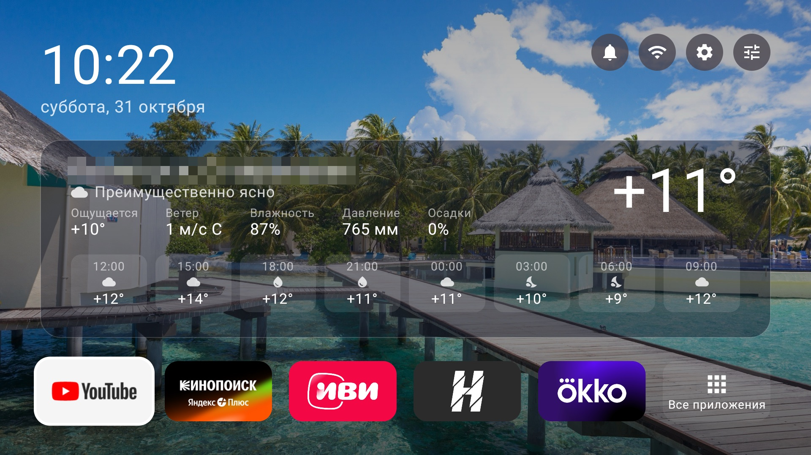

# PolkaTV («Полка»)

Домашний экран в духе Apple TV для Android TV: часы, погода для нескольких городов (OpenWeatherMap; поиск городов через геокодинг Open-Meteo), 4–6 плиток приложений по вашему выбору, служебные иконки (входы, уведомления, сеть, настройки) и фото-фон (12 видов Мальдив). Проверено на Xiaomi MiTV-MOEU1 (Android TV 14) и приставке Xiaomi Mi Box 3 (Android TV 9); минимальная версия — Android 9.



Проект целиком сделан в диалоге с Claude Code — от поиска телевизора в сети до установки и проверки на устройстве. **Как повторить это на своём телевизоре: [docs/HOWTO-with-claude.md](docs/HOWTO-with-claude.md).** Спецификация: `docs/superpowers/specs/2026-10-24-polkatv-launcher-design.md`, план: `docs/superpowers/plans/2026-10-24-polkatv-launcher.md`. Лицензия — MIT.

## Сборка и установка
- Требования: JDK 17+ (проверено на 21), Android SDK (platform 34, build-tools 34.0.0), `local.properties` с `sdk.dir`, свой ключ подписи в `keystore/` (не в git, см. ниже).
- Ключ подписи (один раз; debug и release подписываются им же, поэтому сборки взаимозаменяемы при установке поверх):
  ```bash
  mkdir -p keystore && keytool -genkeypair -v -keystore keystore/polkatv.jks -alias polka -keyalg RSA -keysize 2048 -validity 10000
  ```
  и файл `keystore/keystore.properties`:
  ```
  storeFile=polkatv.jks
  storePassword=<пароль хранилища>
  keyAlias=polka
  keyPassword=<пароль ключа>
  ```
- Прогноз погоды берётся из OpenWeatherMap (Open-Meteo-хост прогноза недоступен из сети ТВ). Ключ: зарегистрируйтесь на openweathermap.org, создайте API-ключ (раздел «API keys»), добавьте строку `owm.apiKey=<ключ>` в `local.properties` (файл в `.gitignore`, в git не попадает) и пересоберите приложение. Без ключа на полке погоды будет надпись «Не задан ключ OpenWeatherMap».
- Лимиты бесплатного тарифа OpenWeatherMap: 60 запросов в минуту; лаунчер делает 2 запроса на город раз в 30 минут. Поиск городов по-прежнему использует геокодинг Open-Meteo.
- `tools/prepare_wallpapers.sh` — пересобрать обои из `design/wallpapers-src/`.
- Адрес устройства задаётся переменной `TV` (по умолчанию телевизор по кабелю `192.168.100.16:5555`; приставка Mi Box 3 — `192.168.100.39:5555`): `TV=192.168.100.39:5555 tools/install_tv.sh`.
- `tools/install_tv.sh` — собрать release и установить; `tools/install_tv.sh --set-home` — ещё и сделать домашним экраном (см. «Домашний экран»). Скрипт сам решает по устройству, отключать ли лаунчер Google TV (только если предпочтительный HOME игнорируется) и выдавать ли разрешение на наложение (только на Android 10+).
- Минимальная версия Android — 9 (API 28), проверено на телевизоре MiTV-MOEU1 (Android 14) и приставке Mi Box 3 (Android 9).
- `./gradlew assembleRelease` — релизная сборка (подписана тем же ключом, поэтому ставится поверх debug: `adb install -r app/build/outputs/apk/release/app-release.apk`).

## Домашний экран
На этом телевизоре лаунчер Google TV (`com.google.android.tvlauncher`) отключён, и кнопка Home открывает «Полку». На прошивке Xiaomi у HOME-фильтра Google TV приоритет 2, у «Полки» — 0 (сторонние приложения поднять приоритет не могут), поэтому одного `set-home-activity` недостаточно.

После перезагрузки прошивка показывает PatchWall («быстрая загрузка»), и «Полка» выводит себя вперёд приёмником `BootReceiver`. Android 14 запрещает запуск активности из фона, поэтому приложению выдано разрешение на наложение поверх окон (`SYSTEM_ALERT_WINDOW`): само наложение нигде не используется, разрешение лишь снимает этот запрет.

Применённые команды (их выполняет `tools/install_tv.sh --set-home`):

```
adb shell cmd package set-home-activity ru.polkatv.launcher/.MainActivity
adb shell pm disable-user --user 0 com.google.android.tvlauncher
adb shell pm grant ru.polkatv.launcher android.permission.SYSTEM_ALERT_WINDOW
adb shell appops set ru.polkatv.launcher SYSTEM_ALERT_WINDOW allow
```

Важно: одного `appops set` недостаточно — прошивка сбрасывает его при загрузке; именно `pm grant` делает разрешение постоянным (проверено перезагрузкой: в логе `BAL_ALLOW_SAW_PERMISSION`, «Полка» на экране через ~10 с после загрузки без нажатий).

При пробуждении из режима ожидания прошивка может поднять наверх задачу PatchWall; `WakeReceiver` возвращает «Полку» вперёд, если в момент выключения экрана она была на экране, а после включения её закрыли (приложение, которое смотрели до сна, не трогается).

Откат одной командой: `tools/restore_googletv.sh` — включает Google TV обратно, снимает разрешение (`pm revoke` + `appops set … default`) и возвращает ему Home. PatchWall (`com.mitv.tvhome.atv` и его сервис `com.mitv.tvhome.michannel`) отключён 2026-10-25 по решению владельца: прошивка больше не поднимает его при загрузке и пробуждении, «Полка» выходит сразу; кнопка PatchWall на пульте не работает. Вернуть: `adb shell pm enable --user 0 com.mitv.tvhome.atv && adb shell pm enable --user 0 com.mitv.tvhome.michannel`. Фоновые фото: с 1.1.1 — 12 видов Мальдив с Pexels (лицензия Pexels, ссылки в `design/wallpapers-src/SOURCES.txt`); до этого были кадры заставки Xiaomi.
## Откат
`tools/restore_googletv.sh` возвращает Google TV как домашний экран. «Полка» остаётся установленной; удалить: `adb shell pm uninstall ru.polkatv.launcher`.

## Управление
- Плитки: OK — запуск, долгое нажатие — заменить/сдвинуть. Последняя плитка — все приложения.
- Погода: ←/→ — города, OK — подробный прогноз, долгое нажатие — добавить/удалить город.
- Иконки справа сверху: входы, уведомления, сеть, настройки ТВ, настройки Полки.

## Приставка Mi Box 3

С 1.1.0 «Полка» стоит и на приставке Xiaomi Mi Box 3 (MIBOX3, Android TV 9, armeabi-v7a, тот же экран 1920×1080 при плотности 320, 2 ГБ памяти; адрес `192.168.100.39:5555`, Wi-Fi). Отличия от телевизора:

- Прошивка приставки тоже даёт HOME-фильтру лаунчера Google приоритет 2, поэтому лаунчер Google TV отключён так же, как на телевизоре (`pm disable-user --user 0 com.google.android.tvlauncher`); откат — `TV=192.168.100.39:5555 tools/restore_googletv.sh`. Панель уведомлений на Android TV 9 живёт в `com.google.android.tvrecommendations` и от лаунчера не зависит.
- На Android 9 нет запрета запуска активности из фона, поэтому разрешение `SYSTEM_ALERT_WINDOW` не выдаётся и не нужно: `BootReceiver` и `WakeReceiver` работают как есть (проверено перезагрузкой и сном/пробуждением; в спящем режиме приставка остаётся в сети).
- HDMI-входов у приставки нет: при пустом списке входов значок входов в шапке скрыт.
- PatchWall (`com.mitv.tvhome.atv`) на приставке остаётся включённым: прошивка держит его в фоне, но экран он не занимает.
- Настройки «Полки» (плитки, города погоды) хранятся на каждом устройстве отдельно; город для погоды на приставке добавляется в её настройках.
- Отладка по сети включается на приставке в настройках разработчика; при первом подключении приставка просит подтвердить отладку с этого компьютера.
- Чистка приставки от лишних фоновых процессов (телеметрия, PatchWall, Assistant, Mi Link, фон кинотеатров) описана в `docs/tv-cleanup/mibox_report.md`; применить/откатить — `docs/tv-cleanup/mibox_cleanup.sh` и `mibox_rollback.sh`.
